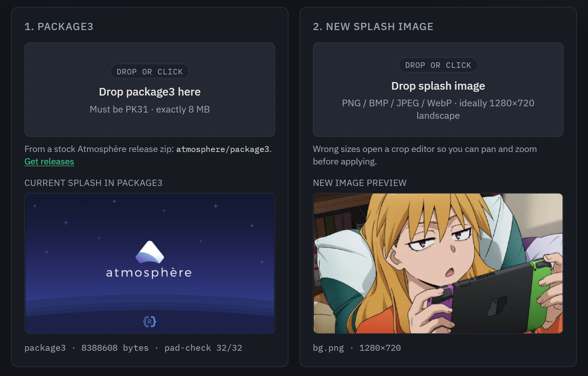

# Atmosphere Splash Injector

**Custom Atmosphère boot splash for Nintendo Switch — in your browser.**

Replace the stock Atmosphère `package3` splash with your own 1280×720 image. Runs entirely client-side: drop files, crop if needed, download the patched `package3`. No uploads, no installers.

[Live demo](https://gtes.github.io/atmosphere-splash-injector/) · [Source](https://github.com/gtes/atmosphere-splash-injector)



Client-side tool that injects a 1280×720 splash into a stock Atmosphère `package3`, matching [`utilities/insert_splash_screen.py`](https://github.com/Atmosphere-NX/Atmosphere/blob/master/utilities/insert_splash_screen.py).

Files never leave your browser. Official Atmosphère only:
https://github.com/Atmosphere-NX/Atmosphere

## Develop

Needs Node.js 20+.

```bat
npm install
npm run dev
```

```bat
npm run build
npm run preview
npm run lint
npm run format
```

Pre-commit runs Prettier + ESLint on staged files via Husky / lint-staged.

## License

GNU General Public License, version 2. See [LICENSE](LICENSE) and [NOTICE](NOTICE).

This project reimplements splash conversion logic from Atmosphère (GPLv2). It is not affiliated with Atmosphere-NX.

## AI assistance

This project was built with [Cursor](https://cursor.com) and reviewed by a human. Use at your own risk.
